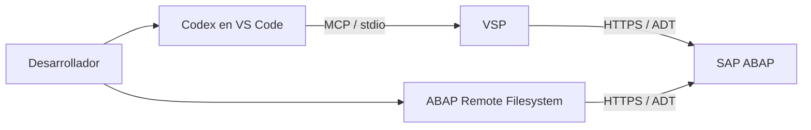

# SAP + Codex + VSP/ADT: prueba de integración

Prueba de concepto de una conexión entre OpenAI Codex en Visual Studio Code y un entorno SAP ABAP mediante [Vibing Steampunk (VSP)](https://github.com/oisee/vibing-steampunk), Model Context Protocol (MCP) y ABAP Development Tools (ADT). Este repositorio documenta una experiencia de instalación, configuración y validación; no contiene un servidor MCP nuevo ni código de un entorno laboral.

## Mi contribución

Investigué la integración, instalé y configuré las herramientas, resolví problemas de conectividad, certificados y autorizaciones, y probé operaciones de lectura y una escritura restringida sobre un programa didáctico ABAP. **VSP y su servidor MCP son obra de los autores del [proyecto original](https://github.com/oisee/vibing-steampunk)**; no los desarrollé.

## Tecnologías y arquitectura

- Visual Studio Code con la extensión OpenAI Codex.
- VSP como servidor MCP existente, con transporte `stdio`.
- Servicios ADT de SAP para consultar y operar sobre objetos ABAP.
- ABAP Remote Filesystem como extensión de VS Code para navegar objetos SAP.

Codex y ABAP Remote Filesystem se configuraron como vías de acceso separadas al mismo entorno. La conexión de Codex comenzó en modo de solo lectura; la escritura se habilitó después con restricciones explícitas.

## Implementación resumida

1. Instalé Codex y ABAP Remote Filesystem en VS Code, y descargué el ejecutable de VSP desde sus releases.
2. Preparé el acceso de red y ADT, registré VSP como servidor MCP en `config.toml` y pasé la contraseña mediante una variable de entorno, sin guardarla en archivos del proyecto.
3. Verifiqué la conexión y la lectura de objetos antes de cambiar las opciones de escritura.
4. Para la prueba de escritura, limité VSP a un paquete y a una orden autorizados, manteniendo deshabilitada la gestión de transportes.
5. Creé un programa de capacitación, comprobé su sintaxis, lo activé y volví a leer el código activo.

El [procedimiento técnico](docs/instalacion.md) detalla la secuencia y separa la configuración histórica de las recomendaciones para una instalación nueva. [La configuración de ejemplo](examples/config.toml.example) usa únicamente valores ficticios y arranca en solo lectura.

## Pruebas y resultados

| Operación | Resultado documentado |
| --- | --- |
| Conexión MCP y lectura ADT | Validada después de corregir la autorización necesaria. |
| Búsqueda y lectura de objetos ABAP | Validadas; se exploraron objetos y se leyó un programa existente sin modificarlo. |
| Análisis asistido de código | Se usó la lectura para consultar información técnica y examinar código existente. |
| Escritura inicial en un paquete temporal | Parcial: se creó el encabezado de un programa, pero faltó autorización para guardar una instrucción adicional. |
| Escritura restringida en un paquete de capacitación | Validada: creación de un programa didáctico con un paquete y una orden permitidos. |
| Sintaxis, activación y lectura posterior | Validadas para ese programa; el código activo coincidió con el aprobado. |

La guía registra una creación completa y un intento de modificación parcial; no demuestra una modificación exitosa de un programa empresarial existente. Tampoco se midieron mejoras de productividad ni se validó la gestión o liberación de transportes desde Codex.

## Problemas y límites observados

- El acceso de red dependía de la conectividad al entorno y de que el servidor estuviera disponible.
- Una falta de autorización ADT impidió inicialmente consultar un recurso técnico; se resolvió habilitando el permiso correspondiente.
- El certificado interno no era reconocido por VSP. Durante la prueba se empleó una excepción de validación TLS; **no es una configuración recomendada para una instalación nueva**. La solución adecuada requiere establecer confianza en el certificado con el equipo responsable y verificar el soporte de VSP para ese entorno.
- La falta de autorización de desarrollo impidió completar la primera escritura. En la prueba posterior fue necesario indicar la orden principal autorizada, en lugar de una tarea asociada, para guardar el objeto.

Estos hallazgos describen el alcance de la prueba; no implican que todos los entornos SAP admitan el mismo flujo o los mismos permisos.

## Posibles aplicaciones empresariales

Con permisos y controles adecuados, una integración de este tipo podría ayudar a:

- Consultar objetos técnicos en lenguaje natural y localizar relaciones entre ellos.
- Comprender y documentar código ABAP existente.
- Preparar cambios repetitivos para revisión y apoyar la verificación de sintaxis.
- Analizar errores y ofrecer un punto de partida para asistentes especializados en SAP.
- Acercar herramientas técnicas a desarrolladores que trabajan en VS Code.

**Caso ilustrativo ficticio:** un desarrollador pide a Codex que lea el programa `ZDEMO_MCP_HELLO`, identifique los objetos relacionados mediante ADT y proponga un cambio acotado. El equipo revisa la propuesta, sus dependencias y el diff; solo entonces autoriza la modificación, ejecuta las verificaciones pertinentes y sigue el proceso de transporte del entorno.

La integración no sustituye las autorizaciones, la revisión humana, las pruebas, los controles de calidad ni los transportes de SAP. Su posible beneficio empresarial requiere validación en cada organización; esta prueba no aporta una medición cuantitativa de productividad.

## Alcance público

Los nombres y valores de los ejemplos son ficticios. La guía original, configuraciones privadas, credenciales, código ABAP laboral y evidencias con datos internos no forman parte de este repositorio.
